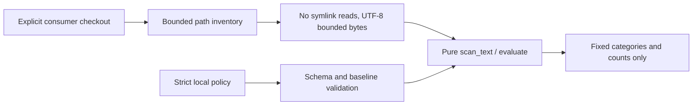

# Value-free bounded consumer wrapper

Proposal before consumer action implementation. Bootstrap engine is preserved
for parity, not approved for arbitrary public-consumer inputs or raw output.

## Boundary

A trusted engine revision receives an explicit checkout root and local policy
as data. No imports, shell commands, hooks, plugins, submodules or configuration
expressions from that checkout. No network or token is needed for this engine.

## Strict input contract

Wrapper command accepts only root and policy paths plus a check-mode flag.
Root must be a directory and Git top-level from an independently checked command
with repository-location environment variables removed. Use NUL-delimited tracked
file enumeration, no filesystem-recursive walk of arbitrary untracked trees.
Paths are relative, normalized and contained; reject symlinks including ancestor
symlinks, traversal, absolute paths, undecodable names and special files. Open
with O_NOFOLLOW when supported and compare stat identity before/after read to
catch replacement. Unsupported secure-open behavior is an error, never fallback.

Default caps: 20,000 tracked paths, 2 MiB per candidate text file, 32 MiB total,
1,000 findings, 1 MiB policy. Limits are engine-owned and cannot be disabled by
consumer config. Oversized input fails a fixed category. Read errors and invalid
UTF-8 fail, not empty input. Select workflow YAML, Dockerfiles and scripts exactly
as the common engine; requirement references are validated relative to root,
contained/tracked and subject to the same limits. No arbitrary absolute baseline.

Policy version 1 enables only Scorecard with a relative baseline path. Reject
unknown keys, duplicate JSON keys and non-string paths. Baseline schema is strict
version 1, bounded entries, known fields and allowed issue-link schemes; evidence
is internal matching data and never output. Local baseline changes are reviewed
consumer policy changes, not engine auto-approval or automatic baseline growth.

## Output and exits

Emit one fixed-schema JSON object: schema_version, check_id, engine_version,
status (pass/fail/error), counts (current/new/stale) and fixed error category.
No raw exception, evidence, fingerprints, baseline reasons, scope strings or
consumer-controlled paths/lines in public output. Do not print the legacy CLI's
inventory or stdout. Even filenames can carry secrets, so first wrapper exposes
counts only. Private detailed inspection remains a separately authorized local
workflow. Exits: 0 pass, 1 new/stale findings, 2 invalid/unavailable input or engine.
No partial scan may pass. Failure categories cannot include attacker text.

## Engine reuse and compatibility

Refactor file enumeration/read boundary behind an injected provider while keeping
pure scan_text/evaluate unchanged and source vectors passing. Shadow comparison
against old engine uses private synthetic/current-tree data, not CI artifacts.
Pin output schema/exit behavior and ensure changes do not silently waive common
rules. The legacy CLI stays unsupported for public consumer logs.

## Supply-chain action

After wrapper review and verified CI, add a thin composite action that invokes
the trusted wrapper from github.action_path against the caller checkout. Inputs
are quoted environment values, never interpolated into shell syntax. Pin outer
and nested actions by full SHA. No checkout of arbitrary ref with secrets or
pull_request_target code execution. Consumer CI keeps its current required gate
and runs shared version in shadow first; another maintainer merges the pilot.

## Tests and mutation bar

Synthetic tests exercise symlink/ancestor escape, file replacement, traversal,
missing Git, weird/newline names, untracked targets, duplicate/unknown schema,
all caps, malformed baseline/UTF-8/read errors and arbitrary secret-like evidence
in a finding. Assert public stdout/stderr never includes that evidence/path.
Mutation checks remove each bound, containment/secure-open, error exit and redaction;
all must be killed. Real-tree parity of normalized findings with old engine plus
actual consumer failure propagation, offline no-network and immutable-pin checks.
No consumer rollout until this bar and fresh verified CI pass. Private Actions
billing exhaustion is a blocker, not permission to merge without the user gate.
