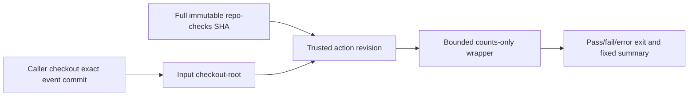

# Composite action boundary and first shadow pilot

Design only. Private Actions billing prevents verified remote CI for this chain;
all PRs stay unmerged, no visibility change, action installation or consumers.

## Interface and placement

Future `actions/scorecard/action.yml` composite action has two string inputs:
checkout-root and policy (default .repo-checks.json). Output is only the wrapper's
fixed JSON summary/status/counts, never raw findings, paths, exception strings,
baseline reasons or fingerprints. Caller's job needs contents:read and no secrets.
Engine modules come from the immutable action revision, not the consumer tree.

Do not invent a checkout step inside the action. Caller checks out its own exact
commit with a full-SHA-pinned checkout action and persist-credentials:false.
Private cross-repo action access/visibility is unresolved: do not broaden access
or make public automatically. Source publication, secret grants and repository
settings are distinct approval/state checks.

## Shell and Python isolation

Pass inputs only through fixed environment variables and quote variable uses.
No direct expression interpolation into shell command source, eval, configurable
commands, downloads or pip install. No token is passed to the scanner. Use a
trusted bootstrap path under github.action_path with isolated Python (-I), which
explicitly inserts only that action's engine source directory. Do not trust
PYTHONPATH, caller cwd, sitecustomize or a consumer module named repo_checks.

The bootstrap validates its action source and caller root are distinct and
uses a fixed interpreter invocation. Wrapper validates policy/root as data.
Inputs beginning with '-' cannot become extra CLI flags; pass explicit option
values without shell expansion or reinterpretation. Reject root that escapes
the supplied caller workspace boundary. Do not print inputs during validation.

Action stdout must contain only the fixed wrapper record. A nonzero wrapper exit
must propagate, not be swallowed by command substitution, tee, continue-on-error
or the summary step. Emit GitHub output through a fixed-name, validated JSON
parser; do not let candidate content inject output delimiters or workflow commands.
No raw inventory/debug artifact. On cancellation or missing output, never pass.

## Pilot after action implementation and verified CI

Use collaboration-docs as the first shadow consumer only. Create its own focused
issue/PR; pin exact reviewed action SHA, pin current mutable checkout@v7, retain
existing required local guard and baseline unchanged. New shared check compares
normalized outcomes and counts without publishing findings; divergence fails the
shadow job and is investigated, not silently baselined. Another maintainer merges
that consumer PR under its local no-author-merge rule.

Do not install into 17 repos at once, replace required contexts or delete copies
in the pilot. No workflow write token or remote configuration update. After the
pilot's exact-head review and fresh green CI, propose one consumer migration PR
at a time, preserving Ginot/WD summary variants and repository-specific rules.

## Tests and review bar

Local hermetic tests simulate malicious input strings, whitespace/newlines,
leading dashes, poisoned PYTHONPATH/cwd/sitecustomize, a fake consumer engine,
missing wrapper output, malformed output and nonzero exits. Assert no injected
command/consumer Python executes and no values leak. Verify action YAML pins and
least permissions in a real caller workflow, plus offline tests without network.

Mutation checks remove quoting/isolation, swap trusted engine for consumer,
swallow exit or echo input; each must be killed. A passing mocked test alone is
not remote action proof: require verified CI on the action and real shadow caller
before removing any old guard. Billing failure remains a hold, never a waiver.
