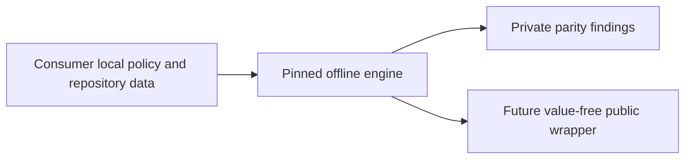

# Shared checks bootstrap

Portfolio design: https://github.com/reihlinstinct/collaboration-docs/pull/26
(reviewed, still awaiting non-author merge). This slice only relocates the exact
common Scorecard engine and synthetic tests; no consumer action is installed.

Engine stays byte-identical for shadow comparison. Source tests change only
import path. Existing raw CLI findings are not safe public-consumer output;
public wrapper, bounds/path containment, immutable action and consumer parity
are separate acceptance slices. Local baselines/private terms never move here.
The initial source scan is not a YAML parser, SAST or security certification.

Keep engines in src/repo_checks, tests in tests, docs in docs, adapters in actions
or tools. CLI schemas and result/exit semantics versioned; no mutable nested
checkout/action refs. No runtime pip installs, arbitrary hooks or PR-code imports.
No mass rollout, automatic rebaseline, account/settings or live external effects.
