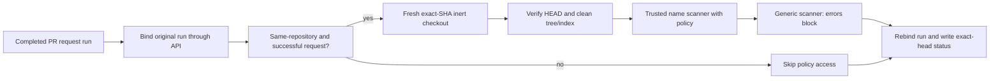

# Trusted name workflow

The reusable workflow is separate from the scanner and pins both actions to the
landed scanner commit. No consumer or required branch status is installed here.

The caller must run on workflow_run for the completed privacy-request.yml run,
from its default branch, and call the reusable workflow at the full landed SHA.
Store PRIVATE_NAME_TERMS_JSON only as a privacy-policy environment secret.
No repository or organization secret of that name may exist: candidate workflows
could read it outside the protected environment. Forward the name explicitly,
even when no repository/organization value exists; never use secrets: inherit. The
privacy-policy environment belongs to the caller repository and must allow only
its exact default branch, with no tag rule and no reviewer or administrator
bypass. Only the
trusted scan step receives the policy. Candidate code is never executed.

Binding requires a public repository, completed pull_request request run,
numeric run/repository IDs and full lowercase candidate SHA. The source run is
re-read through the API. Fork candidates are bound for reporting but cannot enter
the scan job or access its environment. Only trusted same-repository maintainers
may submit candidates. Pass/fail still exposes a single membership bit.

The scan job fetches a fresh inert checkout, verifies HEAD and the clean working
tree/index, then runs the pinned scanner. Input uncertainty fails closed, including
binary, non-UTF8 and oversized content. Generic findings are nonblocking; missing,
error or inconsistent generic results block success. No baselines waive names.

The report job has no checkout or policy. It independently re-reads the source
run and verifies its ID, repository, event, workflow path, completion and exact
SHA before posting. Success also requires same-repository source, successful
request and successful scan. Fork/skipped/failed scans get the same constant
failure description. Invalid binding never grants success. If binding fails, no status is posted;
when a consumer makes this check required, absent status remains pending.

Permissions are split: binding actions:read; scanning contents:read; reporting
actions:read plus statuses:write. One exact Scorecard baseline entry records the
necessary reporter write scope. No wildcard job/write exemption is allowed.
Consumer token defaults must remain read-only; adding write grants to candidate
workflows requires independent review, since a candidate with statuses:write
could forge this status. Making it required is a later explicit settings change.

Tests execute the actual JavaScript and shell bodies against synthetic API and
Git responses. Real environment forwarding and exact-head status are not proved
by these unit tests: the first consumer must prove them before wider adoption.

Secret resolution follows the [GitHub reusable workflow documentation](https://docs.github.com/en/actions/how-tos/reuse-automations/reuse-workflows).
The first consumer must prove environment-only secret resolution with a synthetic
policy before actual-policy adoption. That proof must verify the policy is
nonempty in the trusted scan step only and empty in every other job/step, using
value-free assertions rather than printing it. No repository/organization
duplicate may be created to make that proof pass.
